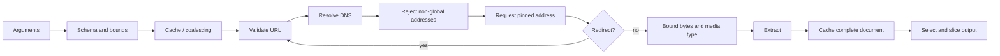
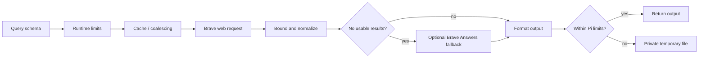

# Architecture

This repository publishes independent Pi packages from `packages/*`. Most packages are extensions that load directly from TypeScript; skill-only packages expose `pi.skills` without `src/index.ts`; prompt-only packages publish Markdown templates through their Pi manifest. Each package owns runtime dependencies and can be installed without the rest of the workspace. Package behavior is documented in the package READMEs; development and release procedures are in [development.md](development.md) and [release.md](release.md).

## Package boundaries

Extension manifests expose one Pi entry point, `src/index.ts`; skill-only packages expose `pi.skills`, while prompt-only packages publish their Markdown resources. Pi APIs are peer dependencies because the host supplies them; the workspace provides a locked development resolution and smoke-tests packed extensions.

`pi-web-fetch` and `pi-web-search` contain byte-identical copies of `cache.ts`, `inflight.ts`, and `render.ts`. `tests/repository-contract.test.ts` detects drift. Extract a shared runtime package only if another consumer appears or synchronized maintenance becomes materially burdensome. Do not extract only part of web-fetch's validate–resolve–pin–redirect security boundary.

## Web fetch trust boundary

The validated address is passed to the transport while the original hostname remains available for TLS and HTTP host validation. Every redirect repeats validation and receives a new pinned target. Resolution, transport, extraction, queueing, retries, and backoff are timeout- and caller-cancellation-aware. Raw responses, retry bodies, extracted content, and output are bounded.

The cache stores the complete extracted document; focused selection derives a separate view without mutating it. Fresh entries are hits. Stale entries may be conditionally revalidated for a bounded window using `ETag` or `Last-Modified`; `304` refreshes the canonical entry. Evidence distinguishes hits, revalidations, and misses.

Retryable `429` and `503` responses honor capped `Retry-After` values or capped jittered backoff with a fixed attempt limit. Origin coordination bounds concurrent request starts.

A linear preflight rejects HTML nested beyond 512 open elements before challenge parsing and extraction. The basic extraction fallback applies the same check; it must not reparse rejected markup. This limits pathological nesting, not every possible source of synchronous extraction cost.

HTML evidence distinguishes JavaScript-required pages, bot walls, consent interstitials, and sparse extraction. Links are bounded metadata only; unsafe schemes and credentials are rejected, and links are never traversed implicitly. Challenge handling stays within the same transport boundary; see the [network notes](network.md#web-fetch-challenges).

The blocked-address table in `packages/pi-web-fetch/src/network/network-policy.ts` follows the [IANA IPv4](https://www.iana.org/assignments/iana-ipv4-special-registry/iana-ipv4-special-registry.xhtml) and [IPv6](https://www.iana.org/assignments/iana-ipv6-special-registry/iana-ipv6-special-registry.xhtml) special-purpose registries. Review it at least quarterly, record the date beside the table, and update endpoint fixtures from reviewed registry data. Registry changes require a security review preserving DNS-answer validation, address pinning, and redirect revalidation.

## Web search boundary

The API key is read at request time and excluded from cache keys, output, and errors. Web search runs first; when it returns no usable results, the extension optionally tries Brave Answers using its separate key. Answers uses Brave's chat-completions endpoint through the same bounded, timeout- and cancellation-aware transport, parsing SSE citation and usage tags into generated-answer metadata rather than search-result evidence. The two request types are separately cached; Answers failures do not conceal cancellation. Neither mode fetches result URLs. Generated answers remain untrusted and do not imply correctness. Answers fallback is controlled solely by availability of its separate API key. Large formatted results use a package-owned temporary directory and are removed after write failure or session shutdown.

Both web tools declare output schemas for programmatic callers. Structured fetch output contains a bounded content chunk with its own continuation offset; JSON escaping may shorten that chunk relative to the text view. Structured search output distinguishes retrieved sources from generated answers and reports omitted payloads with a private full-text file path. Structured output must not exceed byte limits or leak content suppressed from blocked pages.

## Provider requests

`pi-opencode-free` delegates streaming to Pi's OpenAI completions implementation. The adapter preserves caller instrumentation, cancellation, usage accounting, system prompt, and tools while applying the observed gateway contract. Version resolution and the Bun transport use fixed, bounded network paths; see the [network notes](network.md#opencode-free-provider).

Session identifiers use the clock for their timestamp and cryptographic seed material for their suffix. The provider persists an identity privately below the Pi agent directory and reuses it for a local thirty-day retention window with two days of future-clock tolerance. Persistence is best-effort, and temporary writes are atomic and cleaned up after failure. Neither persistence nor the retention window guarantees service access or resets limits.

## Free-tier gateway contract

Bun compatibility is empirical, not evidence of entitlement. Measured on 2026-10-28 against CLI 2.2.0:

| Condition                                                            | Evidence                                                                                                      |
| -------------------------------------------------------------------- | ------------------------------------------------------------------------------------------------------------- |
| The HTTP client must not be Node's `undici` transport                | Byte-identical body and headers: Bun `200`, Node `429`                                                        |
| The system prompt must contain an env block with a working directory | `<env>\n  Working directory: /any/path\n</env>` alone returns `200`; the same prompt without it returns `429` |
| At least one tool must be declared                                   | A tool-free request returns `429`, even with the env block                                                    |
| The request must stream                                              | Non-streaming requests are rejected                                                                           |

Everything else is free to differ: both `/inference/v1` and `/inference/openai/v1` work, and project id, bearer token, tool count, tool names, and prompt text made no difference. The identity headers are checked separately: the client user agent, `x-opencode-client`, and the four session headers are required, while `x-opencode-project` is not. Each session header must carry a `ses_` identifier — an arbitrary string is refused — although the four values need not agree. The identifier's encoded creation time must be recent: an 89-day-old identifier was served while a 91-day-old one was refused. This is why the provider persists one identity and replaces it after thirty days, well inside that window.

The request contract prefixes a minimal working-directory env block unless an instruction already contains one, adds a minimal `read` declaration only when the caller declares no tools, and forces streaming, while keeping Pi's own system prompt and tools. On 2026-10-28 with CLI 2.2.0, `beam-free` returned 200 with these additions, both with normal tools and without caller tools; without the env block or without tools it returned 429. `big-pickle` returned 429 even with an env block and normal tools, which may reflect quota or model availability. These requirements are observed rather than published and can change without notice.

## Command recognition and approvals

`pi-gate` reads command-text rules from `gate.json` and never remembers dialog approvals. A bounded, non-executing recognizer applies word boundaries to simple literal commands and excludes inert `echo`/`printf` argument text and comments. Restrictive flag and numeric suffixes retain prefix coverage; allow exceptions require complete words and cannot suppress another simple command. Pipelines, redirects, expansions, opaque script arguments, malformed quoting, oversized inputs, and rules containing shell syntax retain conservative substring matching. This recognizer is not a Bash parser or sandbox. Persistent exceptions are explicit `allow` rules. Approval dialogs are serialized, cancellation-aware, and revalidate policy after the user responds; policy changes and session starts invalidate pending dialogs.

## Data flow invariants

Keep acquisition, canonical storage, selection, and presentation separate. Cache complete bounded source representations and derive focused or ranked views locally. Derived views report selected or omitted content, preserve source order when practical, and retain deterministic continuation offsets. Relevance and extraction signals describe processing, not source authority or calibrated confidence.

All network optimizations—including revalidation, retries, metadata probes, and redirects—must use the complete transport security boundary. Do not add a client that skips validation, pinning, limits, cancellation, or redirect checks. Expensive rendering and autonomous multi-page traversal are not implicit fallbacks.
