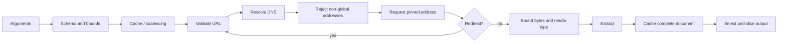
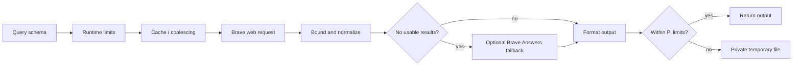

# Architecture

This repository publishes independent Pi packages from `packages/*`. Most packages are extensions that load directly from TypeScript; skill-only packages expose `pi.skills` without `src/index.ts`; prompt-only packages publish Markdown templates through their Pi manifest. Each package owns runtime dependencies and can be installed without the rest of the workspace. Package behavior is documented in the package READMEs; development and release procedures are in [development.md](development.md) and [releasing.md](releasing.md).

## Package boundaries

Extension manifests expose one Pi entry point, `src/index.ts`; skill-only packages expose `pi.skills`, while prompt-only packages publish their Markdown resources. Pi APIs are peer dependencies because the host supplies them; the workspace provides a locked development resolution and smoke-tests packed extensions.

`pi-web-fetch` and `pi-web-search` contain byte-identical copies of `cache.ts`, `inflight.ts`, and `render.ts`. `tests/repository-contract.test.ts` detects drift. Extract a shared runtime package only if another consumer appears or synchronized maintenance becomes materially burdensome. Do not extract only part of web-fetch's validate–resolve–pin–redirect security boundary.

## Web fetch trust boundary

The validated address is passed to the transport while the original hostname remains available for TLS and HTTP host validation. Every redirect repeats validation and receives a new pinned target. Resolution, transport, extraction, queueing, retries, and backoff are timeout- and caller-cancellation-aware. Raw responses, retry bodies, extracted content, and output are bounded.

The cache stores the complete extracted document; focused selection derives a separate view without mutating it. Fresh entries are hits. Stale entries may be conditionally revalidated for a bounded window using `ETag` or `Last-Modified`; `304` refreshes the canonical entry. Evidence distinguishes hits, revalidations, and misses.

Retryable `429` and `503` responses honor `Retry-After` up to the retry budget or use capped jittered backoff with a fixed attempt limit; longer advertised delays return the response without retrying early. Origin coordination bounds concurrent request starts, while a process-wide admission queue bounds complete document acquisitions to 16 active and 128 waiting. The acquisition deadline and caller cancellation include queueing; an acquisition holds its slot through response reading and extraction. Unused redirect and error bodies are destroyed rather than drained.

A linear preflight rejects HTML nested beyond 512 open elements before challenge parsing and extraction. The basic extraction fallback applies the same check; it must not reparse rejected markup. The preflight applies the same implied end tags that linkedom applies for optional-end-tag elements (`p`, `li`, `td`, `th`, `tr`, `dt`, `dd`, `option`, `rt`, `rp`, and table sections), only while the tag is on top of the open-element stack as linkedom's parser does. It tracks SVG and MathML foreign content and their HTML integration points (`foreignObject`, MathML text elements, `annotation-xml`, `desc`, and `title`) before deciding whether self-closing syntax applies; a slash in an unquoted attribute value is ordinary attribute text. Generated documentation that omits most `p` end tags is therefore accepted, while markup whose intervening elements keep those tags open is still refused. This limits pathological nesting, not every possible source of synchronous extraction cost.

HTML evidence distinguishes JavaScript-required pages, bot walls, consent interstitials, and sparse extraction. Links are bounded metadata only; unsafe schemes and credentials are rejected, and links are never traversed implicitly. Challenge handling stays within the same transport boundary; see the [network notes](network.md#web-fetch-challenges).

A blocked Reddit post may fall back to its public Atom feed through the same transport and deadline. Failures retain the block; successful feeds disclose incomplete, flat comments and do not reuse HTML validators. Exact Packit Copr job routes may use the corresponding public API, and an empty Swagger UI may use a literal same-origin advertised specification. The result records these substitutes in structured provenance; Swagger also displays a notice. Redirects remain origin-restricted and use the validated transport, and substitute validators do not revalidate the original page.

The blocked-address table in `packages/pi-web-fetch/src/network/network-policy.ts` follows the [IANA IPv4](https://www.iana.org/assignments/iana-ipv4-special-registry/iana-ipv4-special-registry.xhtml) and [IPv6](https://www.iana.org/assignments/iana-ipv6-special-registry/iana-ipv6-special-registry.xhtml) special-purpose registries. Review it at least quarterly, record the date beside the table, and update endpoint fixtures from reviewed registry data. Registry changes require a security review preserving DNS-answer validation, address pinning, and redirect revalidation.

## Web search boundary

The API key is read at request time and excluded from cache keys, output, and errors. Provider redirects are refused, and untrusted HTTP error bodies are discarded without exposing their contents. Web search runs first; when it returns no usable results, the extension optionally tries Brave Answers using its separate key. Answers uses Brave's chat-completions endpoint through the same bounded, timeout- and cancellation-aware transport, parsing SSE citation and usage tags into generated-answer metadata rather than search-result evidence. The two request types are separately cached; Answers failures do not conceal cancellation. Neither mode fetches result URLs. Generated answers remain untrusted and do not imply correctness. Answers fallback is controlled solely by availability of its separate API key. Large formatted results use a package-owned temporary directory and are removed after write failure or session shutdown.

Both web tools declare output schemas for structured results. Structured fetch output contains a bounded content chunk with its own continuation offset; JSON escaping may shorten that chunk relative to the text view. Structured search output distinguishes retrieved sources from generated answers and reports omitted payloads with a private full-text file path. Structured output must not exceed byte limits or leak content suppressed from blocked pages.

## Provider requests

`pi-opencode-free` delegates streaming to Pi's OpenAI completions implementation. It discovers zero-cost OpenAI chat and Responses catalog entries and uses the gateway's chat translation for both; Responses-specific compatibility flags are not forwarded to the chat adapter. The adapter preserves caller instrumentation, cancellation, usage accounting, system prompt, and tools while applying the observed gateway contract. Version resolution and the Bun transport use fixed, bounded network paths; see the [network notes](network.md#opencode-free-provider).

Session identifiers use the clock for their timestamp and cryptographic seed material for their suffix. The provider persists an identity privately below the Pi agent directory and reuses it for a local thirty-day retention window with two days of future-clock tolerance. Persistence is best-effort, and temporary writes are atomic and cleaned up after failure. Neither persistence nor the retention window guarantees service access or resets limits.

## Free-tier gateway contract

Bun compatibility is empirical, not evidence of entitlement. Measured on 2026-10-28 against CLI 2.2.0:

| Condition                                                            | Evidence                                                                                                      |
| -------------------------------------------------------------------- | ------------------------------------------------------------------------------------------------------------- |
| The HTTP client must not be Node's `undici` transport                | Byte-identical body and headers: Bun `200`, Node `429`                                                        |
| The system prompt must contain an env block with a working directory | `<env>\n  Working directory: /any/path\n</env>` alone returns `200`; the same prompt without it returns `429` |
| At least one tool must be declared                                   | A tool-free request returns `429`, even with the env block                                                    |
| The request must stream                                              | Non-streaming requests are rejected                                                                           |

Everything else is free to differ: both `/inference/v1` and `/inference/openai/v1` work, and project id, bearer token, tool count, tool names, and prompt text made no difference. The identity headers are checked separately: the client user agent, `x-opencode-client`, and the four session headers are required, while `x-opencode-project` is not. Each session header must carry a `ses_` identifier — an arbitrary string is refused — although the four values need not agree. The identifier's encoded creation time must be recent: an 89-day-old identifier was served while a 91-day-old one was refused. This is why the provider persists one identity and replaces it after thirty days, well inside that window.

The request contract ensures one working-directory env block and forces streaming while keeping Pi's own system prompt and tools. Requests without tools receive a synthetic `read` declaration for gateway compatibility. A live `beam-free` compaction on 2026-11-09 succeeded with only its function type and name; parameter schemas and descriptions are omitted. If the model requests a tool in such a call, the adapter reports an error instead of forwarding the tool call. On 2026-10-28 with CLI 2.2.0, `beam-free` returned 200 with these additions, both with normal tools and without caller tools; without the env block or without tools it returned 429. `big-pickle` returned 429 even with an env block and normal tools, which may reflect quota or model availability. These requirements are observed rather than published and can change without notice.

## Compaction on free-tier models

Pi sizes one summary request as `min(model.maxTokens, contextWindow - input - 4096)` and discards any checkpoint whose response stopped at that cap. Free-tier models combine a 200k-300k window with a 32k output limit, so a long history can leave the summary only a few thousand output tokens — fewer than the thinking budget alone when a reasoning level is active — and compaction then fails while overflow recovery gives up.

`pi-opencode-free` handles `session_before_compact` for its own provider only. It defers to Pi whenever one request would still leave the reserve Pi resolved for the session (`settings.reserveTokens`, 16k by default), estimating that request from the serialized messages plus the previous checkpoint, the applicable instructions, the system prompt, and any custom focus, so small histories and native behavior are untouched. Otherwise it splits `messagesToSummarize` at message boundaries using a share of the model's window — 12%, bounded to 4k–60k tokens — summarizes each segment with the session's current model, halves a segment whose digest hits the cap (bounded depth), and trims a single message larger than the budget to it with an explicit marker. It then reduces the digests into one checkpoint with Pi's own summarization system prompt, initial instructions, and — when a checkpoint already exists — its update instructions. Budgets therefore follow the model rather than assuming one: the same code sizes a 200k free-tier window and a 1M window. No request carries an answer cap; Pi's provider layer (`clampMaxTokensToContext`) fits the model's own output limit to the room the prompt leaves, as it does for native compaction.

`session_before_tree` gets the same treatment, because `/tree` asks for a branch summary in one request sized the same way, so a long branch on a free-tier model loses the same output room. That handler reuses Pi's exported `prepareBranchEntries` for entry selection and file operations, then runs the same segmentation and reduction, prepending Pi's branch preamble and using the branch format, which has no critical-context section. It defers on the same rule, honors `userWantsSummary`, and treats `replaceInstructions` the way Pi does — custom instructions become the whole prompt instead of extra focus, and the template check is skipped because the caller's prompt owns the format.

Split turns keep Pi's shape: the turn prefix is summarized separately with Pi's turn-prefix prompt and spliced into the checkpoint under `**Turn Context (split turn):**`, and when nothing precedes the prefix the previous checkpoint — or `No prior history.` — is kept as the baseline. A response that tries to call a tool is rejected as Pi rejects it.

The handler never selects or re-registers a model and never sets `reasoning`: the checkpoint is produced by the model the user chose, and the clamped allowance goes to text rather than thinking. This differs from Pi, which forwards the session thinking level to the summary request whenever the model reasons, and matches OpenCode, whose compaction request carries only an output limit. A final checkpoint whose response stops at the cap is discarded rather than persisted, and one that omits the required sections is re-requested once with a reminder, as OpenCode does before failing a summary that skips its template. Pi's summarization retry policy is not reachable from an extension, so a transient stream failure ends the attempt and Pi's own compaction retries it. Pi exports neither its prompts nor its file-list helpers, so that text is copied and compared with the installed package by `packages/pi-opencode-free/tests/pi-prompts.test.ts`; an upgrade that rewords it fails the test instead of drifting. Everything structural — the event and context surface, `serializeConversation`, `convertToLlm` — is imported and checked by the type checker.

Usage from every request is summed into the compaction entry, and file lists are computed from `preparation.fileOps` and unioned with the previous checkpoint's `details` so cumulative tracking survives repeated compactions. Failures fall back to Pi's own compaction instead of writing a partial checkpoint, and an abort cancels the compaction or the branch summary. Digests that still fill the request budget are trimmed before the checkpoint request, so reduction cannot starve its own output room.

## Command recognition and approvals

`pi-gate` reads command-text rules from `gate.json` and never remembers dialog approvals. A bounded, non-executing recognizer applies word boundaries to simple literal commands and excludes inert `echo`/`printf` argument text and comments. Restrictive flag and numeric suffixes retain prefix coverage; allow exceptions require complete words and cannot suppress another simple command. Pipelines, redirects, expansions, opaque script arguments, malformed quoting, oversized inputs, and rules containing shell syntax retain conservative substring matching. This recognizer is not a Bash parser or sandbox. Persistent exceptions are explicit `allow` rules. Approval dialogs are serialized, cancellation-aware, and revalidate policy after the user responds; policy changes and session starts invalidate pending dialogs.

## Data flow invariants

Keep acquisition, canonical storage, selection, and presentation separate. Cache complete bounded source representations and derive focused or ranked views locally. Derived views report selected or omitted content, preserve source order when practical, and retain deterministic continuation offsets. Relevance and extraction signals describe processing, not source authority or calibrated confidence.

All network optimizations—including revalidation, retries, metadata probes, and redirects—must use the complete transport security boundary. Do not add a client that skips validation, pinning, limits, cancellation, or redirect checks. Expensive rendering and autonomous multi-page traversal are not implicit fallbacks.
