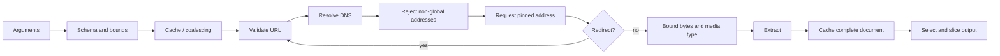
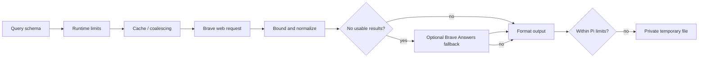

# Architecture

This repository publishes independent Pi packages from `packages/*`. Most packages are extensions that load directly from TypeScript; skill-only packages expose `pi.skills` without `src/index.ts`; prompt-only packages publish Markdown templates through their Pi manifest. Each package owns runtime dependencies and can be installed without the rest of the workspace. Package behavior is documented in the package READMEs; development and release procedures are in [development.md](development.md) and [release.md](release.md).

## Package boundaries

Extension manifests expose one Pi entry point, `src/index.ts`; skill-only packages expose `pi.skills`, while prompt-only packages publish their Markdown resources. Pi APIs are peer dependencies because the host supplies them; the workspace provides a locked development resolution and smoke-tests packed extensions.

`pi-web-fetch` and `pi-web-search` contain byte-identical copies of `cache.ts`, `inflight.ts`, and `render.ts`. `tests/repository-contract.test.ts` detects drift. Extract a shared runtime package only if another consumer appears or synchronized maintenance becomes materially burdensome. Do not extract only part of web-fetch's validate–resolve–pin–redirect security boundary.

## Web fetch trust boundary

The validated address is passed to the transport while the original hostname remains available for TLS and HTTP host validation. Every redirect repeats validation and receives a new pinned target. Resolution, transport, extraction, queueing, retries, and backoff are timeout- and caller-cancellation-aware. Raw responses, retry bodies, extracted content, and output are bounded.

The cache stores the complete extracted document; focused selection derives a separate view without mutating it. Fresh entries are hits. Stale entries may be conditionally revalidated for a bounded window using `ETag` or `Last-Modified`; `304` refreshes the canonical entry. Evidence distinguishes hits, revalidations, and misses.

Retryable `429` and `503` responses honor capped `Retry-After` values or capped jittered backoff with a fixed attempt limit. Origin coordination bounds concurrent request starts.

A linear preflight rejects HTML nested beyond 512 open elements before challenge parsing and extraction. The basic extraction fallback applies the same check; it must not reparse rejected markup. This limits pathological nesting, not every possible source of synchronous extraction cost.

HTML evidence distinguishes JavaScript-required pages, bot walls, consent interstitials, and sparse extraction. Links are bounded metadata only; unsafe schemes and credentials are rejected, and links are never traversed implicitly.

In-process Anubis proof-of-work interstitials are solved inside the same boundary: challenge and pass requests reuse the pinned transport, a server-provided WebAssembly module runs in a worker thread terminated on cancellation with allowlisted imports and a byte/time budget, and cookies live in memory for one acquisition. Methods or extensions outside the in-process set report the standard block.

The blocked-address table in `packages/pi-web-fetch/src/network/network-policy.ts` follows the [IANA IPv4](https://www.iana.org/assignments/iana-ipv4-special-registry/iana-ipv4-special-registry.xhtml) and [IPv6](https://www.iana.org/assignments/iana-ipv6/iana-ipv6-special-registry/iana-ipv6-special-registry.xhtml) special-purpose registries. Review it at least quarterly, record the date beside the table, and update endpoint fixtures from reviewed registry data. Registry changes require a security review preserving DNS-answer validation, address pinning, and redirect revalidation.

## Web search boundary

The API key is read at request time and excluded from cache keys, output, and errors. Web search runs first; when it returns no usable results, the extension optionally tries Brave Answers using its separate key. Answers uses Brave's chat-completions endpoint through the same bounded, timeout- and cancellation-aware transport, parsing SSE citation and usage tags into generated-answer metadata rather than search-result evidence. The two request types are separately cached; Answers failures do not conceal cancellation. Neither mode fetches result URLs. Generated answers remain untrusted and do not imply correctness. Answers fallback is controlled solely by availability of its separate API key. Large formatted results use a package-owned temporary directory and are removed after write failure or session shutdown.

Both web tools declare output schemas for programmatic callers. Structured fetch output contains a bounded content chunk with its own continuation offset; JSON escaping may shorten that chunk relative to the text view. Structured search output distinguishes retrieved sources from generated answers and reports omitted payloads with a private full-text file path. Structured output must not bypass byte limits or leak content suppressed from blocked pages.

## Provider requests and approvals

`pi-opencode-free` delegates streaming to Pi's native OpenAI completions implementation. Its provider-scoped adapter applies the free-tier request contract after any caller payload hook, including tool-free compaction and branch-summary requests. It preserves caller instrumentation, cancellation, and native usage accounting. Only a confirmed free-usage 429 receives a human-readable quota notice; reset times come from `Retry-After`, never an assumed daily schedule. Quota errors format the server-reported reset time in the Pi process's locale and timezone. Quota evidence remains request-local; there is no status command, cached countdown, or inference probe.

The OpenCode Free provider registers the OpenCode inference endpoint with the public token and reads no endpoint, API-key, or CLI-version environment overrides. It resolves the request version lazily at runtime from the official installer's fixed `https://opencode.ai/update/api/latest/cli/npm` metadata endpoint, falling back to `@opencode/cli`'s npm `latest` metadata. Both sources use credential-free HTTPS, no redirects, a five-second per-source deadline, a 64 KiB response bound, and identity and stable-version validation. No remote URL is followed and no installer or binary is downloaded or executed. A shared lookup serves independently cancelable callers and aborts when its last waiter cancels. Only successful versions are cached in memory for 24 hours; failures are retryable, and no synthetic or bundled version is substituted. Registration and offline model refresh make no version request. A published version is traceable upstream metadata, not a guarantee of third-party-client support or an exemption from service limits.

OpenCode Free discovery follows native Pi's four-hour refresh interval, requiring both `checkedAt` and `lastModified` before skipping network access. The persisted entry keeps the visible live selection in `models` and the complete validated free-metadata projection in the provider-owned `catalog` field, with Pi's standard `etag` and `lastModified` fields. Conditional pi.dev requests send `If-None-Match` only when a nonempty metadata body backs the validator; a `304` reuses that body while still applying the refreshed live selection. This retains metadata for models that were not previously live. A `200` replaces metadata and validators; `404`/`501` record an empty overlay with `lastModified: 0` and clear the validator. Other HTTP failures preserve the cached body and validators, advance `checkedAt`, and surface a bounded refresh error, matching native Pi; without prior `lastModified`, those failures remain immediately retryable. Transport, parsing, CLI-version resolution, timeout, and cancellation failures do not advance freshness. Forced refresh bypasses freshness, never offline mode or cancellation. Snapshots are endpoint-scoped, and memory retains only the latest snapshot, including when persistence is unavailable.

`pi-gate` reads command-text rules from `gate.json` and never remembers dialog approvals. A bounded, non-executing recognizer applies word boundaries to simple literal commands and excludes inert `echo`/`printf` argument text and comments. Restrictive flag and numeric suffixes retain prefix coverage; allow exceptions require complete words and cannot suppress another simple command. Pipelines, redirects, expansions, opaque script arguments, malformed quoting, oversized inputs, and rules containing shell syntax retain conservative substring matching. This recognizer is not a Bash parser or sandbox. Persistent exceptions are explicit `allow` rules. Approval dialogs are serialized, cancellation-aware, and revalidate policy after the user responds; policy changes and session starts invalidate pending dialogs.

## Data flow invariants

Keep acquisition, canonical storage, selection, and presentation separate. Cache complete bounded source representations and derive focused or ranked views locally. Derived views report selected or omitted content, preserve source order when practical, and retain deterministic continuation offsets. Relevance and extraction signals describe processing, not source authority or calibrated confidence.

All network optimizations—including revalidation, retries, metadata probes, and redirects—must use the complete transport security boundary. Do not add a client that bypasses validation, pinning, limits, cancellation, or redirect checks. Expensive rendering and autonomous multi-page traversal are not implicit fallbacks.
